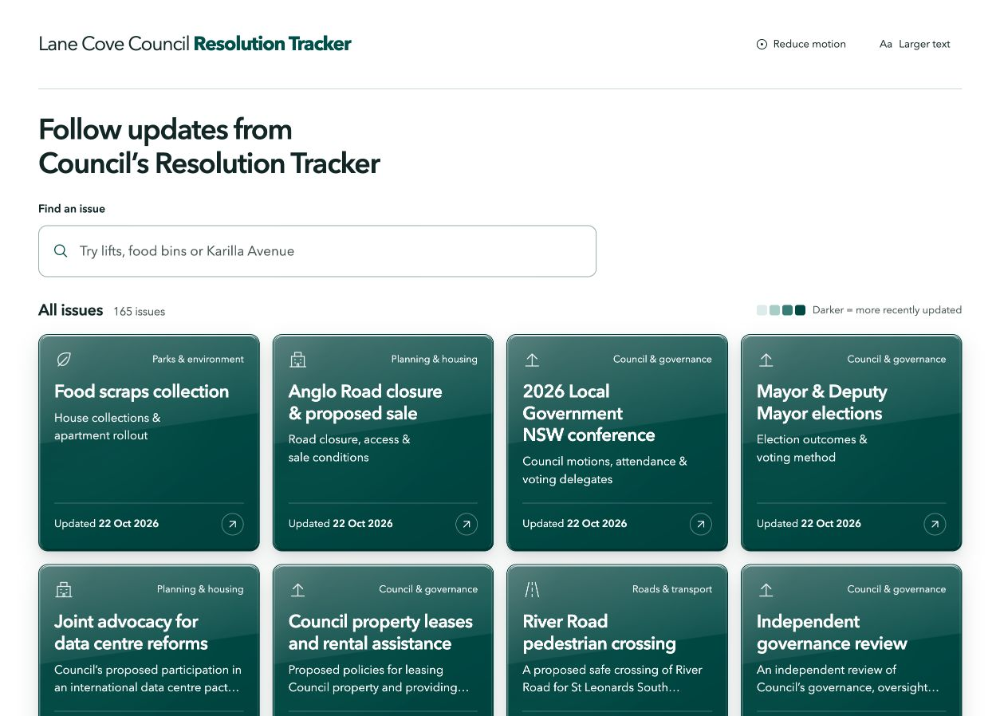

# Lane Cove Council Resolution Tracker

An independent website covering every resolution listed in the nine 2026 Resolution Tracker editions available through 22 October 2026. The catalogue groups 221 in-scope resolutions into 165 issue pages and includes 38 related earlier decisions. It retains 1,014 dated timeline positions and 901 complete tracker rows across 37 distinct editions from April 2023 to October 2026.



Not affiliated with Lane Cove Council. Production website: **https://lanecovetracker.wlsn.me/**. GitHub Pages publishes the verified `dist/` files after successful checks on `main`. This repository contains the static website, reviewed source data, a source scanner and a portable PDF row extractor. Read [the local setup guide](docs/LOCAL-SETUP.md) and [daily task instructions](docs/DAILY-TASK.md). The local ChatGPT task performs scanning, extraction and AI processing; GitHub Actions checks and deploys the committed result. Execution location is explicit in `monitor/execution.json`; the previous cloud schedule remains paused. The same workflow can move entirely to cloud later.

Run the buildless site locally:

```sh
python3 -m http.server 5173 --bind 127.0.0.1 --directory dist
```

Rebuild the data and check source coverage:

```sh
python3 catalogue/build_catalogue.py
node scripts/verify-catalogue.cjs
node scripts/verify-route-motion.cjs
node scripts/verify-source-links.cjs
node scripts/verify-browsing.cjs
node --check dist/app.js
```

`catalogue/structured/` retains extracted physical table columns and source metadata. Editorial files contain resident-facing summaries. `catalogue/historical-links.json` records explicit earlier-phase links; minutes verification records document source-number corrections and adoption checks. `dist/coverage.json` is the downloadable coverage inventory. PDFs are linked directly from Council rather than bundled in the website. Rebuilding does not fetch new editions.

The interface keeps compact glossy tiles, live search, date-based shading, pointer tilt and reversible two-face flip transitions. Only visible tiles participate in navigation animation. Desktop histories use a compact elapsed-time dot overview above newest-first expandable update rows. The latest update opens by default; dots and the date-only selector open the matching row. Phones retain the chronological vertical timeline and start with no update expanded. Category checkboxes start with all categories selected and combine with the search; selections survive opening and returning from an issue. Phones keep the vertical list and an inline update reader. Original wording and PDF links accompany every summary; complete repeated monthly rows remain under the source disclosure.

## Source limits and rules

- September 2023's official attachment returns a file-extraction error. Its agenda links the file but does not embed it. This gap is disclosed, not reconstructed.
- December 2023 links November's identical PDF and is not counted as a fresh snapshot.
- Identify resolutions by number **and year**. Some PDFs contain duplicate, blank or malformed numbers; verified aliases retain an explanation and minutes links.
- Keep decision dates, officer-comment dates and tracker publication dates distinct. Status and target changes are dated to publication, not assumed work-completion dates.
- A completed resolution can mean a report or administrative task was completed. It does not establish that an entire issue is resolved.
- A target field is not automatically a delivery commitment. An absent or unchanged entry does not establish inactivity or completion.
- Preserve source variants and complete rows. Do not silently replace historical wording or treat agenda recommendations as adopted decisions.

## Repository layout

| Directory | Purpose |
| --- | --- |
| `dist/` | Complete buildless website; the verified Pages artifact. |
| `catalogue/` | Normalized source rows, reviewed summaries, provenance and reproducible builder. |
| `monitor/` | Accepted PDF identity/hash baseline. |
| `scripts/` | Catalogue, animation regression and scanner checks. |
| `.github/workflows/` | Verification on pushes/PRs, Pages deployment after checks on main, and an optional manual diagnostic scan. No daily scan schedule or AI processing. |
| `docs/` | Update architecture and screenshot. |

The site uses local HTML/CSS/JavaScript assets and requires JavaScript. No framework, backend, API key or external font is needed. Links to original records open Council's external websites. Python 3 builds catalogue data; Node runs the verification scripts. The optional source scanner uses curl and the pinned Python dependency in `requirements-monitor.txt`; it contacts Council's public servers.

The original PDF research archive is not bundled. `catalogue/structured/` contains the source rows needed to reproduce the site, and `monitor/baseline.json` records hashes of the original PDFs. Preserve accepted future PDFs in a durable archive as described in the update proposal.

For either execution location, install the shared pinned dependencies from `requirements-cloud.txt` in `.venv` and run `bash scripts/verify.sh`. The filename is retained for compatibility. Real October PDF extraction and changed-edition acceptance have been rehearsed without publishing simulated data. Row extraction remains staged for agent review; the release inventory is independently checked. See [LOCAL-SETUP.md](docs/LOCAL-SETUP.md) for current operation and [CLOUD-SETUP.md](docs/CLOUD-SETUP.md) for future cloud migration.

Website tracker links use Council's permanent `GenDocLink.asp?RecId=...` document records. Council resolves those records to its current PDF location; saved `documents_TE/` download paths can expire. Page references remain in the source data, but the website opens the whole PDF without a page fragment. A live audit of all 37 cited editions is recorded in `monitor/trials/source-links-2026-10-22.json`.

No reuse license has been selected. Council source material retains its original provenance. This package was exported from the reviewed site source at commit `99e3c0ced388865f17594dbd893f5b721dab3137`; hosting-specific metadata, deployment credentials and source history are excluded.
