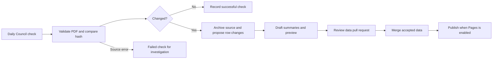

# Keeping the tracker current

## Recommendation

Use GitHub Actions to check Council's public agenda index once a day. Discovery can be automatic; changes to residents' timelines should initially arrive as a reviewed data update. Publishing the website is a separate step.

The repository contains a **working read-only scanner and a manual Actions workflow**. There is no daily schedule, automatic summary generation, automatic merge, or Pages deployment enabled.

The first live test on 22 October 2026 checked all 17 listed 2026 agendas (ordinary, supplementary and extraordinary) and all nine tracker PDFs. The downloaded PDF hashes matched the reviewed source archive; there were no errors or pending changes. A second test covered both 2025 and 2026: 36 agendas and 20 PDFs, again with no differences or errors. Its full report is saved in `monitor/trials/2026-10-22.json`. See `monitor/baseline.json` for the accepted source identities and SHA-256 hashes.

## Daily process

1. Search the Council agenda index for the current and previous calendar years. Include supplementary and extraordinary agendas, and do not assume a particular monthly meeting date. Checking the previous year also covers late publication across New Year.
2. Find **all** Resolution Tracker attachments in each agenda. Follow Council's document redirect, verify that the result opens as a PDF and contains tracker text, then hash the complete bytes.
3. Compare with the accepted baseline. Report a new attachment, revised bytes at an existing address, or an old PDF linked by another agenda. An HTTP error, missing known agenda or broken attachment must be visible as a failure, not “nothing new”.
4. Keep a report and changed PDFs for review. The trial stores these as private repository workflow artifacts for 30 days. Download and preserve accepted source files before they expire; artifacts alone are not a permanent evidence archive.
5. Extract proposed row changes, check them, draft summaries, and open a data pull request. This ingestion/PR stage is **a proposed next step, not implemented by the scanner**.
6. Review the source comparison and preview, then merge. Once Pages is separately approved and configured, a deployment workflow can publish the accepted `dist/` files.



## What is already testable

From the repository root, with Python 3.12 and curl installed:

```sh
python3 -m venv .venv
.venv/bin/python -m pip install -r requirements-monitor.txt
.venv/bin/python -m unittest discover -s scripts -p 'test_*.py'
.venv/bin/python scripts/scan_trackers.py
```

The scan produces `scan-output/report.json`, a readable `summary.md`, and hash-named copies of changed PDFs. It never edits `catalogue/`, `dist/` or `monitor/baseline.json`. Source errors return a nonzero exit code. New/revised/reused PDFs set `needs_review: true` in the report; these are successful discoveries, not network failures. The manual workflow can be run from GitHub's Actions tab and needs no Council credentials or AI API key.

This is comparison against the **accepted catalogue**, not the previous scan. An unreviewed change will be reported again until it is accepted. There is deliberately no automatic baseline advance that could cause a pending change to disappear.

## What needs review before a data update

| Change | Treatment |
| --- | --- |
| New resolution | Add a new issue or link to an existing issue only with evidence; retain number and year. |
| New dated officer comment | Add the dated note; distinguish its date from publication and decision dates. |
| Repeated unchanged comment | Retain the monthly source row without manufacturing a new progress event. |
| Status or target changed | Show the change as observed in that edition. A target is not a delivery promise. |
| Resolution marked Completed | Explain what that resolution required; do not automatically close the wider issue. |
| Row missing | Flag the difference. Do not infer completion. |
| Blank/malformed/duplicated number | Stop automatic matching for that row and request source review. |
| Different PDF at the same URL | Preserve both revisions, with hashes and first-seen timestamps; review corrections. |
| Same PDF under a later agenda | Record the duplicate reference; do not count it as a fresh edition. |
| Source unavailable or layout changed | Report the problem and leave published data intact. |

The existing extractor required manual corrections for table continuations, blank identifiers and source inconsistencies. A production ingestion step should keep raw columns, page references and confidence/errors, rather than letting an AI read a PDF and rewrite the whole catalogue. AI can draft short factual summaries from verified row differences. Those drafts should retain source citations and be reviewed before publication.

The catalogue builder currently fixes membership to the nine 2026 editions (221 resolutions). Before accepting the next edition, make that scope explicit and update the coverage checks with an independently derived inventory. At the 2027 rollover, retain existing issue histories and decide whether to expand membership to every new year's tracker; do not silently drop 2026 issues.

## Turning on the daily scan later

After a successful GitHub-hosted trial and agreement on notifications, add a daily `schedule` trigger to `.github/workflows/scan-trackers.yml`. A proposed time is 07:17 Australia/Sydney. Use GitHub's documented timezone-aware scheduling, or a documented UTC equivalent; verify the supported syntax when enabling it. GitHub schedules can be delayed and only run from the default branch, so this is a daily check, not a guaranteed delivery time. Public repositories' schedules may be disabled after 60 days without repository activity.

The next useful addition is one deduplicated review pull request per source edition/revision, with a link to the report, changed rows and a preview. It should remain open until reviewed, rather than generating a fresh alert every day. Choose the notification destination before implementing it; the manual trial only has an Actions summary/artifact and normal failed-workflow notifications according to the account's GitHub settings. Successful discovery currently does **not** send a dedicated change notification.

The current workflow uses `contents: read` only. Creating pull requests later needs narrowly scoped write permissions and repository settings that permit the chosen mechanism. Do not add a personal access token or AI key to the static website. A paid AI service, if selected later, belongs in Actions secrets and needs a defined usage limit. The scanner itself uses no AI service; GitHub-hosted runner usage depends on the account's Actions allowance.

Before publication, also choose a permanent PDF evidence archive and a stale-data display policy. The website's “Records through” date should mean the latest accepted source edition, while “Last checked” should be separate and only advance after a successful scan. Never show today's date as if the underlying data were refreshed.

## Trial limits

- Rechecks current/previous-year PDFs to detect same-address revisions; this costs more downloads than metadata-only checks but avoids trusting unreliable modification headers.
- Does not monitor revisions to every historical PDF forever, search for unlinked attachments, or inspect non-Council committee agendas.
- Depends on Council's ASP.NET index form, agenda HTML and document redirect conventions. Tests cover known shapes, not future redesigns; missing expected structures fail visibly.
- Checks basic PDF readability and tracker identity; it does not yet extract, compare or approve rows.
- Reports changed files in expiring artifacts until a durable review/archive stage is implemented.

## Sources

- [Council agenda archive](https://lanecove.infocouncil.biz/)
- [GitHub workflow events, manual runs and schedule behaviour](https://docs.github.com/en/actions/reference/workflows-and-actions/events-that-trigger-workflows)
- [GitHub workflow permissions](https://docs.github.com/en/actions/reference/workflows-and-actions/workflow-syntax#permissions)
- [GitHub artifact action and retention](https://github.com/actions/upload-artifact)
